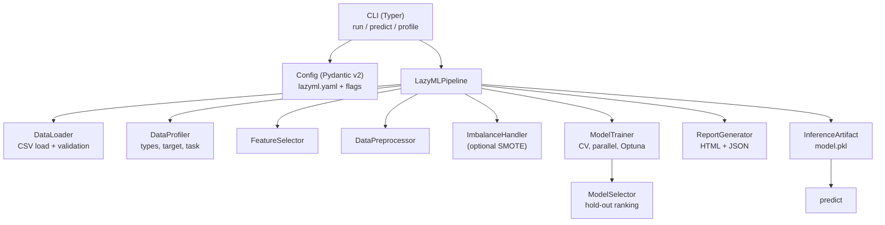
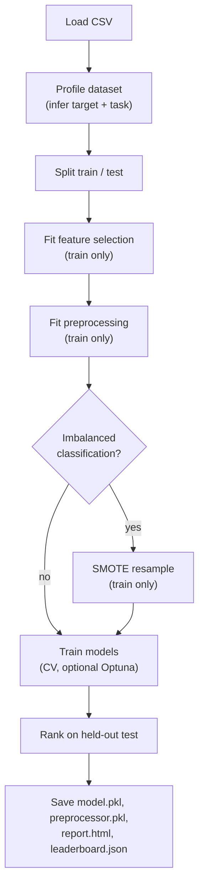
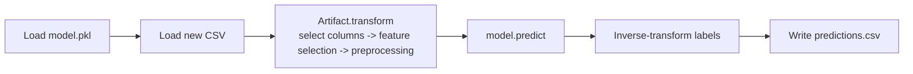

<div align="center">

# LazyML

**Automated machine learning for CSV datasets, from a single command.**

Profile a dataset, train and compare multiple models with leakage-safe preprocessing, and export the best model for prediction.

[](https://www.python.org/)
[](https://typer.tiangolo.com/)
[](https://docs.pydantic.dev/)
[](https://scikit-learn.org/)
[](https://pandas.pydata.org/)
[](https://optuna.org/)
[](https://docs.astral.sh/ruff/)
[](https://mypy-lang.org/)
[](https://docs.pytest.org/)
[](#license)

</div>

---

## Overview

LazyML is a command-line tool that automates the common machine learning workflow on a single CSV file:

1. **Load and validate** the dataset.
2. **Profile** it to detect column types, missing values, a likely target column, and the task type.
3. **Split first**, then fit feature selection and preprocessing on the training split only, so no test-set information leaks into model selection.
4. **Train** several scikit-learn models (plus optional gradient-boosting libraries) with cross-validation, optional parallelism, and optional Optuna tuning.
5. **Rank** models on a held-out test split and **export** the best one, a fitted preprocessing artifact, an HTML report, and a JSON leaderboard.

Configuration is optional: sensible defaults work out of the box, and a `lazyml.yaml` file can set persistent defaults that command-line flags always override.

## Features

All features below are implemented and covered by the test suite.

- **Dataset profiling** (`lazyml profile`): row/column counts, per-column dtype, missing-value counts, cardinality, duplicate-row detection, target-column suggestion, and classification-vs-regression detection.
- **Leakage-safe pipeline**: the train/test split happens before any stateful fitting. Feature selection, imputation, scaling, encoding, and SMOTE resampling are fit on the training split only and applied unchanged to the test split.
- **Automatic preprocessing**: median imputation and standardization for numeric columns; constant imputation and one-hot encoding for categorical columns. Unknown categories seen at prediction time are ignored rather than raising.
- **Feature selection**: low-variance removal, highly-correlated-feature removal, and univariate model-based selection, with a `transform` step that reapplies the exact selected columns at prediction time.
- **Multi-model training**: logistic/linear models, random forest, extra trees, gradient boosting, AdaBoost, decision tree, KNN, SVM, and Gaussian Naive Bayes, with optional XGBoost, LightGBM, and CatBoost.
- **Cross-validation**: stratified K-fold for classification, K-fold for regression.
- **Parallel training**: models train concurrently across processes, with a configurable worker count.
- **Hyperparameter optimization**: optional Optuna tuning with a TPE sampler and median pruner, per-model time budgeting.
- **Class-imbalance handling**: imbalance detection and optional SMOTE oversampling on the training split.
- **Ensembling**: soft-voting (classification) and stacking (regression) over the top models.
- **Reproducible prediction** (`lazyml predict`): a self-contained inference artifact bundles the raw-column contract, fitted feature selector, and fitted preprocessor so predictions reproduce training-time preprocessing exactly and map labels back to their original values.
- **Reports**: an HTML report and a JSON leaderboard are written to the output directory.
- **Typed configuration**: `lazyml.yaml` is validated with Pydantic v2; unknown keys and invalid values are rejected early.

## Tech Stack

| Area                    | Technology                                             |
| ----------------------- | ------------------------------------------------------ |
| Language                | Python 3.11+                                           |
| CLI framework           | Typer, Rich (terminal output)                          |
| Configuration           | Pydantic v2, PyYAML                                    |
| Data handling           | pandas, NumPy                                          |
| Modeling and pipeline   | scikit-learn                                           |
| Model persistence       | joblib                                                 |
| Hyperparameter tuning   | Optuna (optional)                                      |
| Gradient boosting       | XGBoost, LightGBM, CatBoost (optional)                 |
| Imbalance handling      | imbalanced-learn (optional)                            |
| Lint and format         | Ruff                                                   |
| Type checking           | mypy (strict)                                          |
| Testing                 | pytest, pytest-cov, Hypothesis                         |
| Docs                    | Sphinx, Furo, MyST, sphinx-copybutton (optional)       |
| Build backend           | Hatchling                                              |
| CI                      | GitHub Actions                                         |

## Prerequisites

- **Python 3.11 or newer.**
- **[uv](https://docs.astral.sh/uv/)** (recommended) for environment and dependency management, or `pip`.

## Installation

### Using uv (recommended)

```bash
git clone https://github.com/username/lazyml.git
cd lazyml
uv venv
uv pip install -e .
```

### Using pip

```bash
git clone https://github.com/username/lazyml.git
cd lazyml
python -m venv .venv
# Linux/macOS
source .venv/bin/activate
# Windows PowerShell
.venv\Scripts\Activate.ps1
pip install -e .
```

### Optional extras

Install only what you need. Extras can be combined (for example `.[boost,optuna]`).

| Extra        | Adds                                      | Enables                                   |
| ------------ | ----------------------------------------- | ----------------------------------------- |
| `boost`      | XGBoost, LightGBM, CatBoost               | Additional gradient-boosting models       |
| `optuna`     | Optuna                                     | The `--optuna` hyperparameter tuning flag |
| `imbalanced` | imbalanced-learn                          | SMOTE oversampling for imbalanced classes |
| `tui`        | Textual                                    | Terminal UI dependency                    |
| `polars`     | Polars                                     | Polars dependency                         |
| `dev`        | pytest, pytest-cov, Hypothesis, mypy, Ruff | The development workflow                   |
| `docs`       | Sphinx, Furo, MyST, sphinx-copybutton     | Building the documentation                |

```bash
# A common combination
uv pip install -e ".[boost,optuna,imbalanced]"

# Development
uv pip install -e ".[dev]"
```

Optional model libraries are detected at runtime: if XGBoost, LightGBM, or CatBoost are not installed, those models are skipped and the rest of the run proceeds normally.

## Usage

LazyML exposes three commands: `run`, `predict`, and `profile`.

```bash
lazyml --help
lazyml run --help
```

### Profile a dataset

```bash
lazyml profile data.csv
```

Prints a dataset summary and per-column details without training anything.

### Train

```bash
lazyml run data.csv --target target_column
```

If no file is passed, `run` enters an interactive prompt for the file and target. If `--target` or `--task` are omitted, LazyML infers them from the dataset profile.

```bash
lazyml run data.csv \
  --target price \
  --task regression \
  --time-budget 600 \
  --cv-folds 5 \
  --output-dir ./models \
  --ensemble \
  --optuna \
  --optuna-trials 50
```

### Predict

```bash
lazyml predict ./output/model.pkl new_data.csv --output predictions.csv
```

`new_data.csv` must contain the original feature columns (the target column is not required). Predictions are written with a single `prediction` column and are mapped back to the original label values for classification.

### `run` options

| Option                                          | Description                            | Default      |
| ----------------------------------------------- | -------------------------------------- | ------------ |
| `--target`, `-t`                                | Target column name                     | auto-detect  |
| `--task`                                        | `classification` or `regression`       | auto-detect  |
| `--time-budget`                                 | Maximum training time in seconds       | `300`        |
| `--cv-folds`                                    | Cross-validation folds                 | `5`          |
| `--output-dir`, `-o`                            | Directory for output files             | `./output`   |
| `--ensemble`                                    | Enable ensemble methods                | `False`      |
| `--feature-selection / --no-feature-selection`  | Automatic feature selection            | enabled      |
| `--handle-imbalance / --no-handle-imbalance`    | Handle class imbalance                 | enabled      |
| `--parallel / --no-parallel`                    | Train models in parallel               | enabled      |
| `--max-workers`                                 | Maximum parallel workers               | auto         |
| `--optuna`                                       | Enable Optuna tuning (needs `optuna`)  | `False`      |
| `--optuna-trials`                               | Optuna trials per model                | `30`         |
| `--config`, `-c`                                | Path to a `lazyml.yaml` file           | auto-discover |

### Output files

A successful `run` writes the following into the output directory:

```
output/
├── model.pkl          # Best model bundled with its inference artifact
├── preprocessor.pkl   # Fitted preprocessing pipeline
├── report.html        # HTML report with the dataset summary and leaderboard
└── leaderboard.json   # Model rankings and metrics (JSON)
```

## Configuration

Configuration is optional. When a `lazyml.yaml` (or `lazyml.yml`) file exists in the current directory, `run` loads it automatically; a specific file can be passed with `--config`. Command-line flags always take precedence over file values.

```yaml
# lazyml.yaml
target: price
task: regression          # classification | regression | auto
output_dir: ./models
ensemble: false
feature_selection: true
handle_imbalance: true
parallel: true
max_workers: 4
random_state: 42

models:
  include: []             # reserved (see note below)
  exclude: []             # reserved (see note below)

optimization:
  time_budget: 600
  use_optuna: true
  n_trials: 50

cross_validation:
  folds: 5
  strategy: auto          # reserved (see note below)
```

Unknown keys and out-of-range values are rejected with a clear error, so typos surface immediately rather than being silently ignored.

The following keys are validated by the schema but not yet applied at runtime: `models.include`, `models.exclude`, and `cross_validation.strategy`. The cross-validation strategy is currently chosen automatically (stratified K-fold for classification, K-fold for regression), and all available models are trained.

## Environment Variables

LazyML reads no runtime environment variables. All behavior is controlled through command-line flags and the optional `lazyml.yaml` file described above. There is no `.env` file to configure.

## Development

Install the development extras, then use the commands below.

```bash
uv pip install -e ".[dev]"
```

| Task              | Command                                         |
| ----------------- | ----------------------------------------------- |
| Run tests         | `uv run pytest`                                  |
| Tests with coverage | `uv run pytest --cov --cov-report=term-missing` |
| Lint              | `uv run ruff check src tests`                    |
| Format            | `uv run ruff format src tests`                   |
| Format check      | `uv run ruff format --check src tests`           |
| Type check        | `uv run mypy`                                     |
| Run the CLI       | `uv run lazyml --help`                           |

### Continuous integration

GitHub Actions runs on every push and pull request to `main`. The workflow installs the project with `uv` on Python 3.11 and 3.12 and runs Ruff (lint and format check), mypy, and pytest with coverage. See `.github/workflows/ci.yml`.

### Documentation

```bash
uv pip install -e ".[docs]"

# Linux/macOS
cd docs && uv run make html

# Windows PowerShell
cd docs; uv run sphinx-build -M html source build
```

The built site is written to `docs/build/html/index.html`.

## Architecture



## Workflows

### Training (`run`)



### Prediction (`predict`)



## Project Structure

```
src/lazyml/
├── cli/        # Typer command-line interface
├── config.py   # Pydantic v2 configuration (lazyml.yaml)
├── core/       # Loader, profiler, preprocessor, feature selection, imbalance, pipeline
├── models/     # Trainer, selector, ensemble builders
├── optim/      # Optuna search spaces and tuner
└── reports/    # HTML and JSON report generation
```

## Deployment

LazyML is distributed and run as a Python package; there is no server component.

Build a wheel with the configured Hatchling backend:

```bash
uv build
```

This produces a wheel and source distribution in `dist/`. Install the wheel into any Python 3.11+ environment to make the `lazyml` command available:

```bash
pip install dist/lazyml-0.1.0-py3-none-any.whl
lazyml --help
```

Include the optional extras your workload needs when installing, for example `pip install "lazyml[boost,optuna] @ ."`.

## License

MIT
